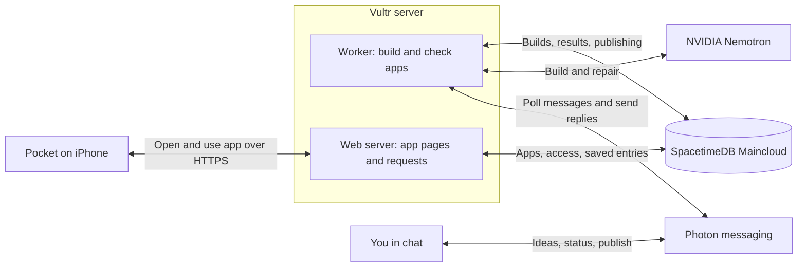
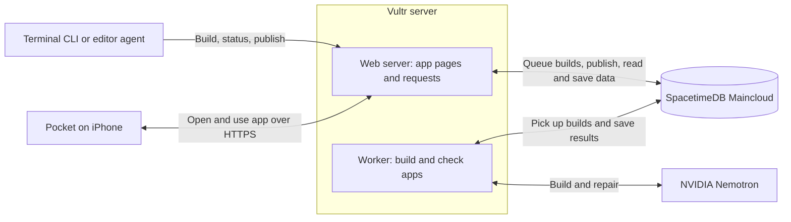

# Pockett

## Overview

Pockett turns a prompt into a small app you can open and share in Pocket on iPhone. Build through a messaging agent, an editor agent, or the terminal.

It currently supports lists, number trackers, and polls with up to eight fields. Apps use a shared page template; their data lives in SpacetimeDB.

## Architecture

### Build through an agent

Send an idea through Photon messaging. The worker asks NVIDIA Nemotron to build and check the app. Send `publish` when it is ready to add it to Pocket.



### Build through the terminal

The CLI sends requests to the web server. The same worker builds the app; `publish` adds it to Pocket. An editor agent uses these same operations through the included MCP tools.



Caddy handles HTTPS on Vultr. SpacetimeDB stores accounts, access rules, builds, and app data. Apps read and save through the web server; visible apps refresh shared data every five seconds.

## Deploy apps

### 1. Set up Pocket once

You need Node 24+, Spacetime CLI 2.14+, and an Ubuntu Vultr server with Docker, Compose v2, and working root SSH. Point your domain to the server and allow ports 80 and 443.

From this repository:

```sh
npm ci --prefix Developer
npm ci --prefix Spacetime/spacetimedb
cp -n .env.example .env
spacetime login
```

Set `NVIDIA_API_KEY` and `NEMOTRON_MODEL` in `.env`, then deploy:

```sh
npm --prefix Developer run deploy -- pocket.example.com --host YOUR_VULTR_IP
```

This publishes the database to SpacetimeDB Maincloud, starts the web server and worker on Vultr, and checks their connection. Run `npm --prefix Developer run deploy` again for updates or retries.

For a new server, editor setup, or troubleshooting, see [deployment details](docs/DEPLOY.md). For local development, see [local setup](docs/SETUP.md).

### 2. Build and publish an app

Open `Pocket.xcodeproj` in Xcode and run Pocket on an iPhone or simulator. Set **Profile → Test server** to your deployed HTTPS URL and create an account.

In the terminal, replace the example domain and username. Login reads your password from `POCKET_PASSWORD`; this zsh command keeps it out of history:

```sh
read -s 'POCKET_PASSWORD?Pocket password: '; export POCKET_PASSWORD
node Developer/src/cli.ts login --backend https://pocket.example.com --username YOU
unset POCKET_PASSWORD
node Developer/src/cli.ts build 'A shared grocery list' --backend https://pocket.example.com
node Developer/src/cli.ts status BUILD_ID --backend https://pocket.example.com
node Developer/src/cli.ts publish BUILD_ID --backend https://pocket.example.com
node Developer/src/cli.ts open APP_ID --backend https://pocket.example.com
```

Use the build ID returned by `build`. Wait for `status` to say `ready`, then publish and use the returned app ID. `open` prints a private link. Publishing uses the existing server and database.

**Through messaging:** configure the three `PHOTON_*` values in `.env` for your Photon project and agent sender, then redeploy. After CLI login, run:

```sh
node Developer/src/cli.ts connect-photon --backend https://pocket.example.com
```

Send the returned `link CODE` to your agent within five minutes. Then send `build a grocery list`, `status`, and `publish`. Use `change add a quantity field` to revise it.

**Through an editor agent:** [connect the MCP tools](docs/DEPLOY.md#use-it-from-your-editor-through-mcp), then ask it to build, check status, and publish using your backend URL.

## Solana Pay

Generated apps can optionally request SOL payments for tips, club dues, or contributions. Include the amount and recipient's public address in your prompt:

> Build a club dues tracker with a 0.01 SOL payment request to MY_PUBLIC_ADDRESS.

Replace `MY_PUBLIC_ADDRESS` with the intended recipient's Solana address. The app shows the amount and recipient, then opens a compatible wallet for approval. Pocket holds no private keys. Check the wallet's network before approving.

Solana provides the payment handoff; app data stays in SpacetimeDB. This version creates payment requests only: it does not verify settlement, mark entries paid, or prevent repeat payments. See the [Solana Pay guide](docs/SOLANA-PAY.md) for setup, testing, and limitations.

## A few notes

- These are small generated apps, not deployments of arbitrary source code. Existing websites can also be [added to Pocket](Developer/README.md#cli), with their own hosting.
- Keep `.env` and private app links private. Share through Pocket to give someone their own access.
- `Pocket/` is the iPhone app, `Developer/` holds the CLI and editor tools, `Runtime/` runs the web server and worker, and `Spacetime/` holds data and access rules. `Backend/` is the older Python backend.
